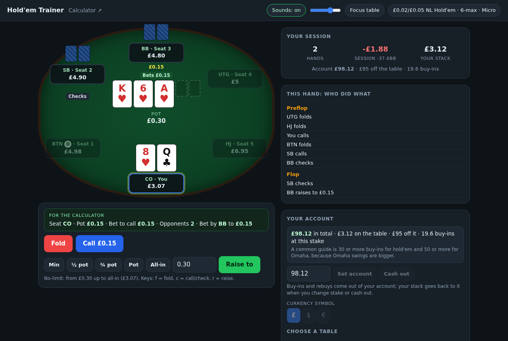
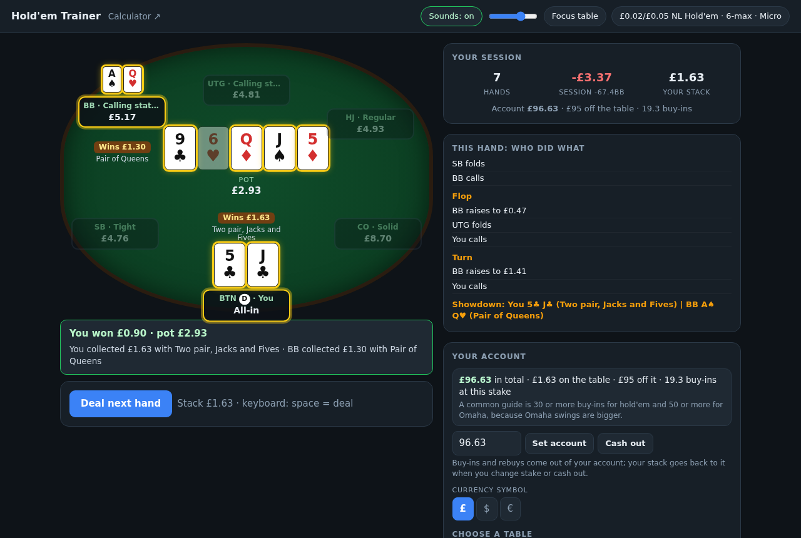
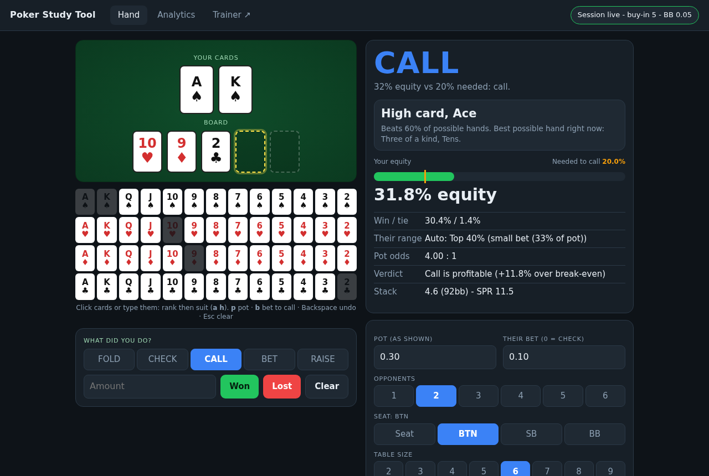
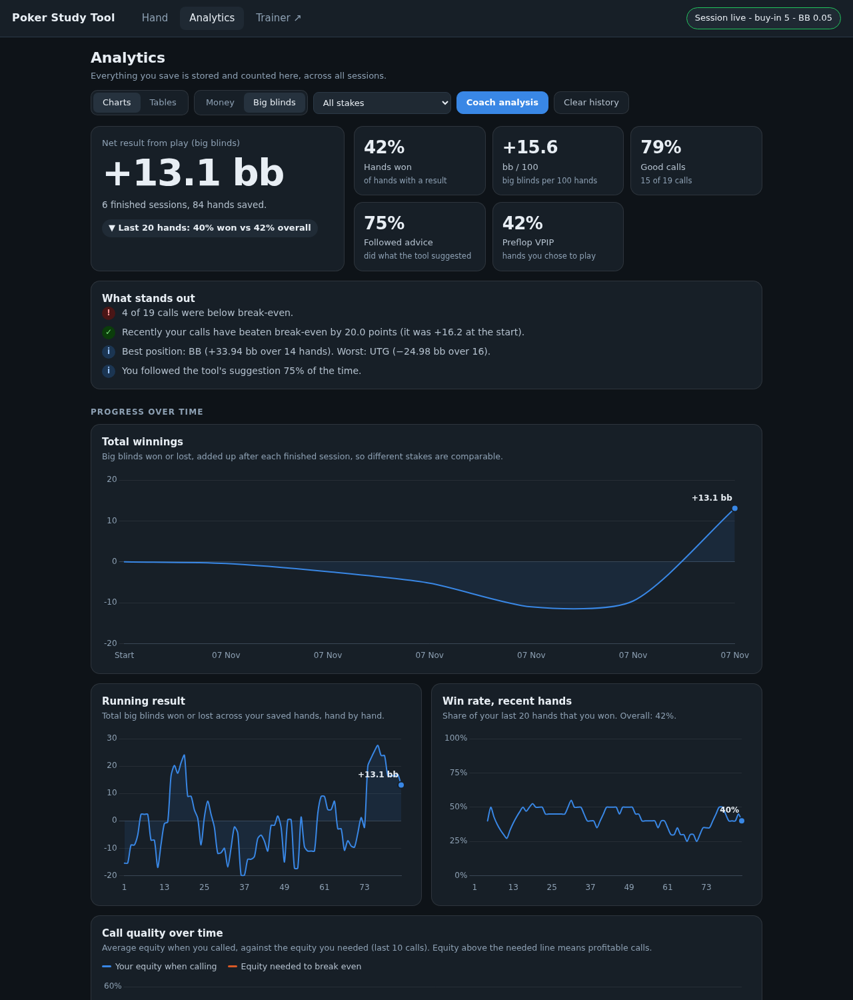
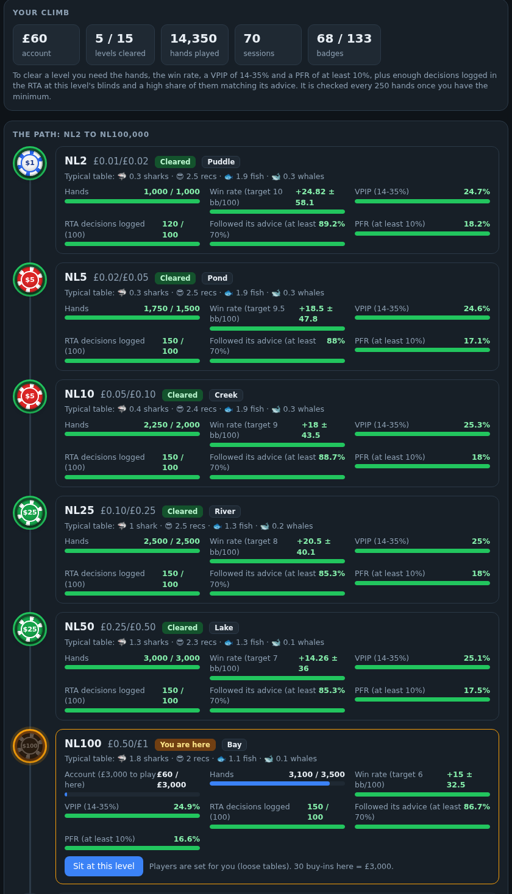
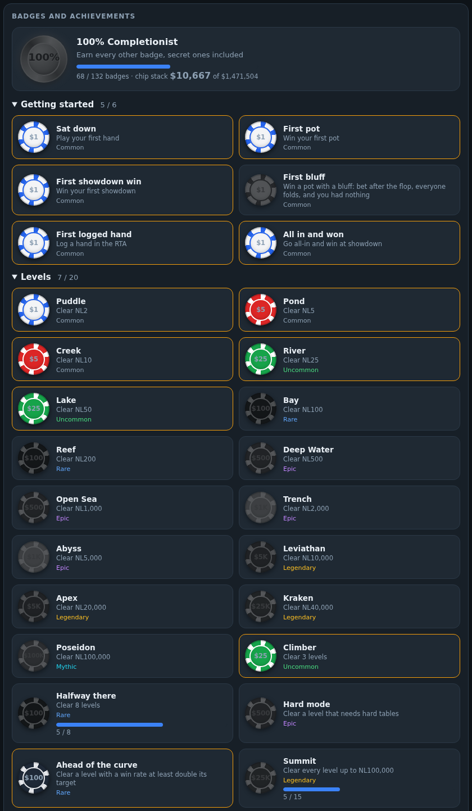
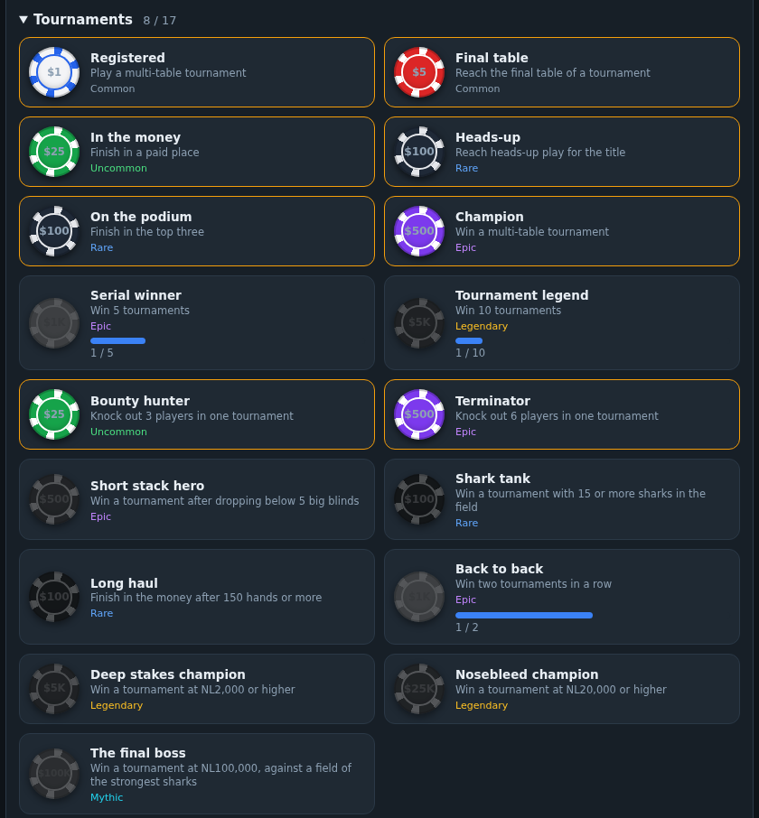

# Poker Study Tool (play-money only)

Manual-entry equity / pot-odds / analytics app. No screen reading, OCR, overlay or client automation.

    python3 server.py       # opens the app in your browser (localhost only)
    python3 -m pytest -q    # tests

Needs: eval7, flask (Chart.js is bundled in static/).

**Your save file stays on your own computer.** Everything you play (hands, sessions, stack, badges) is stored in `poker.db`, a local SQLite file
created on first run. Nothing is sent to a server, and the game never uploads your data. See "Where your data lives" below to move it.

Licence: MIT (see `LICENSE`).

Limits: it knows nothing about how your opponents play, it is not a GTO solver, and the
preflop guide and check/call/raise suggestion are simple rules of thumb.

## Windows download (no Python needed)

Go to the **Releases** page of this repository and download `PokerStudy-windows.zip`. Unzip it and double-click `PokerStudy.exe`: a black window opens
and the game appears in your browser (close the black window to quit). Windows may warn that the program is from an unknown publisher the first time
(**More info**, then **Run anyway**). Your game is saved on your own computer, in `%APPDATA%\PokerStudyTool`, so updating the program never loses it.

The zip is built by the workflow in `.github/workflows/build-windows.yml` (run it from the Actions tab, or push a tag such as `v1.0.0` to publish a release).
To run from the code instead: `pip install -r requirements.txt`, then `python launcher.py` (or `python server.py`).

## Screenshots

**Casino: a flop decision at a £0.02/£0.05 table.** Each seat shows its last action, "For the RTA" gives the numbers to type into the RTA page, and the other players take a moment to act.

**Showdown.** The winner's seat and the five cards that make the winning hand are highlighted, and every hand shown is named.

**RTA.** Equity against the opponent's range, pot odds, outs and a suggested action for the spot you type in.

**Analytics.** A Money / Big blinds switch and a stake filter keep results at different stakes comparable.

**Grinding: the levels.** A ladder from NL2 to NL100,000. Each level locks a table strength, shows the mix of sharks, recs, fish and whales you will meet there, and asks for a win rate, a sensible VPIP and PFR, and enough RTA decisions that follow its advice before the next level opens.

**Grinding: badges and achievements.** Poker-chip badges for levels, pots, showdowns, bluffs, all-ins, big hands and more, with progress bars and a rarity on each.

**Tournament badges.** Multi-table tournaments have their own group, from "Registered" to "The final boss".

(The screenshots use demo data.)

## Casino (play against bots)

http://127.0.0.1:5173/trainer (the RTA page has a "Casino" link): you against five bots at No-Limit Hold'em, so the
RTA can stay open in one browser window and the Casino in another.
- Tables are listed like an online lobby, from NL2 ($0.01/$0.02) up to $500/$1,000, each with a buy-in range of 40bb to
  100bb. Higher stakes have more sharks and fewer weak players.
- Every opponent has a nickname and one of four types, easiest to hardest: **Whale** (a weak big spender who plays almost
  every hand), **Fish** (calls too much or splashes around), **Rec** (a decent amateur with leaks) and **Shark** (the
  strongest: tight, aggressive, hard to exploit). Each player has their own numbers and habits.
- Table strength (Loose / Balanced / Hard) shifts how many weak players and sharks sit there.
- Account: it starts at 30 buy-ins of NL2 and only moves with your results (it cannot be edited). To sit at a higher level
  you need that level cleared on the Grinding page and 30 buy-ins of it; below 20 buy-ins of your level you are moved down;
  if you go bust (below the NL2 minimum buy-in) you get a free starter balance back at NL2. The currency symbol
  (£ / $ / €) is only a label; nothing is converted.
- Players come and go: a short stack either tops up or leaves and a new player sits down in their seat, a player who has won a lot
  sometimes cashes out, and now and then anyone gets up. The table news says who.
- Three modes: **Grinding** (levels, account and settings work like online), **Practice** (any settings, its own account, never
  counts towards Grinding) and **Tournament**.
- **Tournament**: a multi-table tournament of 36 players on six 6-max tables. Everyone starts with the same chips and the blinds
  rise every few hands. Each level has its own structure, like real online MTTs: the low entries start with 3,000 chips (100 big blinds)
  and no antes until late, while the bigger ones start with up to 200 big blinds, play slower levels and add antes earlier. Every table plays at once (the other tables are played by the bots), players who bust are out with their
  finishing place, tables are kept balanced and broken as players go out (so your opponents change, and your own table can be
  broken), and the last six play the final table. The top five are paid, top-heavy. The entry fee comes out of the same account
  as cash and the prize goes back into it, and tournaments have their own
  ladder, separate from the cash levels (shown on the Grinding page): to clear a level, finish in the money twice (three times above the three lowest levels), play at least 8 tournaments there and be in profit
  there (prizes at least equal to the entries; up to NL200 a loss of no more than one entry is allowed), so you can climb without playing any cash, and there is a badge group for the ladder. Only tournaments played in the Casino count, and the entry
  just has to fit your account. The bots play a cash-game style, so they are not tournament experts and the RTA's advice ignores the prize structure.
- Game speed (Instant / Fast / Normal / Slow): the other players take a moment to act, like an online table. Each bot has
  its own tempo, many folds are snap folds, big decisions take longer and now and then someone tanks. The seat that is
  about to act glows with "thinking", Skip jumps to your turn, and the shot clock only starts when it is your turn.
- Game feel: cards are dealt from the dealer, the flop/turn/river flip onto the board, chips slide into the pot and to
  the winner. Sounds (deal, flip, chips, check, fold, your turn, a win) are synthesised in the browser, so there are no
  audio files. A "Sounds" button and a volume slider are in the header and are remembered.
- Optional shot clock (10-60 seconds, enforced by the server), a stack you can set to any amount, rebuys, and "Ask the
  tool" to see what the RTA would say. A "For the RTA" strip shows the numbers to type into it.
- Your stack, settings and the players are saved in `poker.db` (tables `trainer_state`, `trainer_hands`) and are included
  in the end-of-session backup. A hand in progress is not saved. The server holds one Casino table.
- The bots play the tool's published preflop charts, then bend them with habits; postflop they use their own logic,
  not the tool's advice. Check them with `python3 -m pokercalc.stats --hands 600` (VPIP, PFR, limp, 3-bet, fold to
  3-bet, c-bet, fold to c-bet, showdown rate, aggression, with target ranges from forum posts and HUD guides, not data).
- Headless test of the advice against the bots: `python3 -m pokercalc.sim --hands 400 --stake 0.02/0.05`.

## Grinding

The **Grinding** page is a ladder of levels, NL2 up to NL100,000, with a badge for each. You clear a level, in order, with
enough hands at it (only hands at your current level count, and the harder levels only count hands at tough enough tables),
a win rate above the level's target, a VPIP and PFR like a winner's, and enough decisions logged in the RTA at that level's
blinds with a high share of them matching its advice. The targets are our own starting numbers (see `pokercalc/grind.py`);
over a few thousand hands a win rate is still mostly luck, so each level shows its margin of error. Beating bots is practice,
not proof that you beat real people.

There are also badges and achievements for pots won, showdowns, bluffs, all-ins (including against each named shark), big
hands, and using and following the RTA. A pop-up appears when you earn one or clear a level, and it is tagged NEW on the
Grinding page until you refresh.

## Analytics across stakes

The Analytics tab has a **Money / Big blinds** switch and a **stake filter** (by big blind). Money adds up your real winnings,
so a result at a bigger stake counts for more; big blinds divide every result by its own big blind, so a win at a small
stake and a loss at a bigger one can be compared fairly (the bb/100 figure and the winnings-in-big-blinds line already did
this). When you have played more than one stake, the page warns you that the money charts mix them. Tables show both. The
analytics cover the hands you log in the RTA and every Casino hand played while Grinding, in Practice or in a tournament, so you can play the Casino without the RTA and still see your results. When you log a tournament in the RTA, Start session has a Tournament option: you enter the entry fee, type your hands in tournament chips with the current big blind, and at the end enter how you finished and what you won. A Cash / Tournaments / All switch separates the formats: tournament hands are shown in big blinds only (their chips are not money, so they never mix into cash profit), and a Tournaments card shows entries, prizes, ROI and finishing places. A hand is always ONE row: if you also type a Casino hand into the RTA, it fills in that same row (matched by the cards and the time), and the database refuses a second row for the same Casino hand.

## Where your data lives

Your hands, sessions and Casino data are in `poker.db` and backed up as plain JSON lines. By default both are inside
the project folder. The backup is committed only when the folder is inside a git repo, and it is never pushed to a PUBLIC repo
(so a fork of this project never publishes your hands). To keep your data **out of the code**, put it in its own
folder (ideally its own PRIVATE git repo) and tell the apps where it is:

    python3 -m pokercalc.backup migrate ~/poker-data     # run in each app's folder: COPIES the data, never moves or deletes it
    cd ~/poker-data && git init                          # then make it a private repo on GitHub and add it as "origin"
    export POKER_DATA_DIR=~/poker-data                   # for example in ~/.bashrc, then restart the apps

Each app keeps its own subfolder there (`holdem/`), holding `poker.db` and `backup/`. At the end of a session the
backup is committed (and pushed, if the repo is private and has a remote) in THAT repo, never in the code repo. Unset,
nothing changes. Keep the old files until you have checked the apps show your hands and the analytics look right.
Run the tests with the variable unset or pointing at a throw-away folder: they never touch your real data either way.
